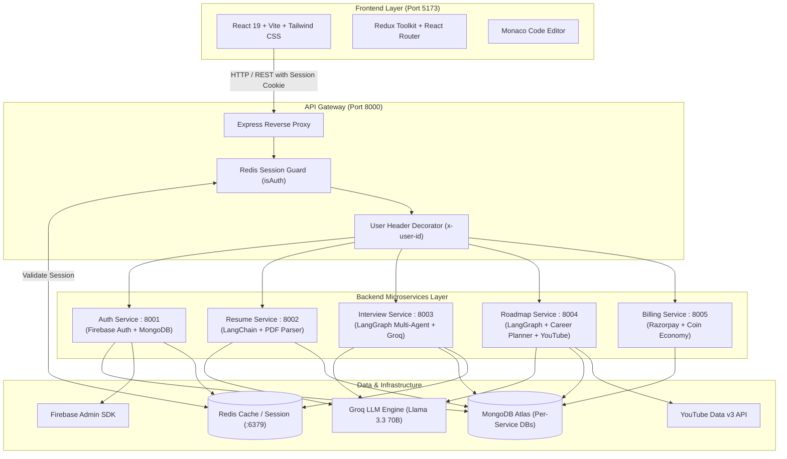

# 🚀 CareerForge AI

<div align="center">


> **An End-to-End AI-Powered Career Preparation & Acceleration Platform**  
> Built with a high-performance **Microservices Architecture**, **LangGraph Multi-Agent Workflows**, **Groq LPU LLMs**, **Redis Distributed Caching**, and a modern **React 19 + Vite** frontend.

[](https://react.dev/)
[](https://vitejs.dev/)
[](https://nodejs.org/)
[](https://expressjs.com/)
[](https://langchain.com/)
[](https://groq.com/)
[](https://redis.io/)
[](https://www.mongodb.com/)
[](https://razorpay.com/)
[](LICENSE)

</div>

---

## 📚 Complete Project Documentation

For exhaustive deep-dives into the architecture, design decisions, and code-level logic, refer to:

- 📖 **[Comprehensive Project Explanation](project_explanation.md)**: System design, LangGraph multi-agent workflows, state machines, business logic, coin metering, and security overview.
- 🌲 **[Project Structure & File Logic Guide](project_structure.md)**: Exhaustive file tree with detailed code logic explanations for every single backend service, controller, agent, model, route, frontend page, component, and utility.

---

## 📌 Table of Contents
- [Overview](#-overview)
- [Key Features](#-key-features)
- [System Architecture](#-system-architecture)
- [Tech Stack](#-tech-stack)
- [Microservices Breakdown](#-microservices-breakdown)
- [Environment Configuration](#-environment-configuration)
- [Security & Credentials Protection](#-security--credentials-protection)
- [Getting Started](#-getting-started)
  - [Prerequisites](#prerequisites)
  - [⚡ One-Click Startup (Windows)](#-one-click-startup-windows)
  - [Manual Step-by-Step Startup](#manual-step-by-step-startup)
- [API Gateway Routing Table](#-api-gateway-routing-table)
- [How to Upload to GitHub](#-how-to-upload-to-github)
- [License](#-license)

---

## 🌟 Overview

**CareerForge AI** is an intelligent career guidance ecosystem designed to help job seekers land their dream roles. It bridges the gap between preparation and real-world hiring standards through AI-driven mock interviews, ATS resume scoring and generation, personalized learning roadmaps, and an integrated coin-based credit system.

---

## ⚡ Key Features

### 🎙️ 1. AI Mock Interview Simulator & Monaco Code IDE
- **Multi-Agent Interview Flow**: Orchestrated by **LangGraph** (`interviewAgent`, `feedbackAgent`, and `summaryAgent`).
- **Technical & HR Tracks**: Tailor sessions to specific software engineering job positions or HR behavioral interviews.
- **Resume-Aware Questions**: Generate questions specifically targeting projects and technologies listed in the candidate's resume.
- **Integrated Monaco Code Editor**: Real-time coding workspace with syntax highlighting and code assessment.
- **Comprehensive Score Reports**: In-depth analytics highlighting strengths, weaknesses, code correctness, and communication with interactive **Recharts** charts.

### 📄 2. ATS Resume Scorer & Analyzer
- **PDF Resume Parsing**: Extracts structured text and analyzes candidates against targeted job roles using `pdf-parse` and Groq LLMs.
- **Actionable ATS Feedback**: Highlights keyword matches, formatting suggestions, missing qualifications, and an objective ATS readiness score (0-100).

### 📝 3. Interactive AI Resume Builder
- **Real-Time Editor**: Dynamic, multi-section form synchronized globally via Redux Toolkit.
- **ATS-Optimized Formatting**: Clean, single-column layout designed specifically to maximize ATS scanner pass rates.
- **Export to PDF**: Generate clean, print-ready PDF resumes using `react-to-print`.

### 🗺️ 4. Adaptive Career Roadmap Generator
- **Personalized Learning Paths**: Generates step-by-step milestones, recommended resources, and skill prerequisites tailored to individual career targets and compensation levels.
- **Direct Video & Doc Links**: Automatically links official documentation and relevant tutorial lectures from YouTube using the YouTube Data v3 API.

### 💳 5. Credit Economy & Billing
- **Coin-Based Metering**: Transparent usage pricing for AI-intensive actions (50 coins per interview, 25 coins per resume review, 20 coins per roadmap).
- **Payment Gateway**: Seamless checkout and top-ups powered by **Razorpay** with cryptographically verified HMAC-SHA256 signatures.

---

## 🏗️ System Architecture



---

## 🛠️ Tech Stack

| Domain | Technologies |
|---|---|
| **Frontend** | React 19, Vite, Tailwind CSS v4, Redux Toolkit, Framer Motion, Monaco Editor (`@monaco-editor/react`), Recharts, React-to-Print |
| **API Gateway** | Express.js, `express-http-proxy`, Morgan, Cookie-Parser, CORS |
| **AI & Agent Orchestration** | LangChain (`@langchain/core`, `@langchain/groq`), LangGraph (`@langchain/langgraph`), Groq API (Llama 3.3 70B) |
| **Backend Services** | Node.js (ES Modules), Express.js v5, Mongoose, Multer, `pdf-parse` |
| **Authentication & Security** | Firebase Authentication, Firebase Admin SDK, HttpOnly Cookie Sessions, Redis Session Store |
| **Databases & Cache** | MongoDB Atlas, Redis (via `ioredis` and Docker) |
| **Payments** | Razorpay SDK & HMAC-SHA256 signature verification |
| **External APIs** | YouTube Data v3 API, Groq Inference Cloud |
| **DevOps & Tooling** | Docker Compose, Batch Automation Scripts (`.bat`), ESLint |

---

## 🔌 Microservices Breakdown

| Service | Port | Directory | Primary Purpose |
|---|---|---|---|
| **API Gateway** | `8000` | `backend/gateway` | Request routing, proxying, auth validation, and cookie handling |
| **Auth Service** | `8001` | `backend/services/auth` | User identity, Firebase Admin sync, profile data, initial coin allocation |
| **Resume Service** | `8002` | `backend/services/resume` | Resume PDF parsing, AI ATS scoring, resume structure generation |
| **Interview Service** | `8003` | `backend/services/interview` | LangGraph multi-agent live mock interview engine & report analyzer |
| **Roadmap Service** | `8004` | `backend/services/roadmap` | AI-driven customized career learning paths and YouTube tutorials |
| **Billing Service** | `8005` | `backend/services/billing` | Razorpay order creation, payment verification, and credit balances |
| **Redis** | `6379` | `backend/docker-compose.yml`| Shared distributed cache and session store |
| **Frontend** | `5173` | `frontend` | SPA Client user interface |

---

## ⚙️ Environment Configuration

Template files (`.env.example`) are provided in every service. Create the corresponding `.env` files prior to launching:

```bash
# 1. API Gateway
cp backend/gateway/.env.example backend/gateway/.env

# 2. Auth Service
cp backend/services/auth/.env.example backend/services/auth/.env
cp backend/services/auth/serviceAccountKey.example.json backend/services/auth/serviceAccountKey.json

# 3. Billing Service
cp backend/services/billing/.env.example backend/services/billing/.env

# 4. Interview Service
cp backend/services/interview/.env.example backend/services/interview/.env

# 5. Resume Service
cp backend/services/resume/.env.example backend/services/resume/.env

# 6. Roadmap Service
cp backend/services/roadmap/.env.example backend/services/roadmap/.env

# 7. Frontend
cp frontend/.env.example frontend/.env
```

### Environment Variable Reference

- **`backend/gateway/.env`**:
  ```env
  PORT=8000
  REDIS_URL="redis://localhost:6379"
  AUTH_SERVICE_URL="http://localhost:8001"
  RESUME_SERVICE_URL="http://localhost:8002"
  INTERVIEW_SERVICE_URL="http://localhost:8003"
  ROADMAP_SERVICE_URL="http://localhost:8004"
  BILLING_SERVICE_URL="http://localhost:8005"
  FRONTEND_URL="http://localhost:5173"
  ```
- **`backend/services/auth/.env`**:
  ```env
  PORT=8001
  MONGODB_URL="mongodb+srv://<user>:<password>@cluster0.mongodb.net/user"
  REDIS_URL="redis://localhost:6379"
  ```
- **`backend/services/billing/.env`**:
  ```env
  PORT=8005
  MONGODB_URL="mongodb+srv://<user>:<password>@cluster0.mongodb.net/billing"
  RAZORPAY_KEY_ID="rzp_test_yourKeyId"
  RAZORPAY_KEY_SECRET="yourRazorpaySecret"
  ```
- **`backend/services/interview/.env`**:
  ```env
  PORT=8003
  MONGODB_URL="mongodb+srv://<user>:<password>@cluster0.mongodb.net/interview"
  REDIS_URL="redis://localhost:6379"
  GROQ_API_KEY="gsk_yourGroqKey"
  ```
- **`backend/services/resume/.env`**:
  ```env
  PORT=8002
  MONGODB_URL="mongodb+srv://<user>:<password>@cluster0.mongodb.net/resume"
  REDIS_URL="redis://localhost:6379"
  GROQ_API_KEY="gsk_yourGroqKey"
  ```
- **`backend/services/roadmap/.env`**:
  ```env
  PORT=8004
  MONGODB_URL="mongodb+srv://<user>:<password>@cluster0.mongodb.net/roadmap"
  REDIS_URL="redis://localhost:6379"
  GROQ_API_KEY="gsk_yourGroqKey"
  YOUTUBE_API_KEY="yourYouTubeApiKey"
  ```
- **`frontend/.env`**:
  ```env
  VITE_FIREBASE_APIKEY="your_firebase_web_api_key"
  VITE_RAZORPAY_KEY_ID="rzp_test_yourKeyId"
  VITE_BACKEND_URL="http://localhost:8000"
  ```

---

## 🔒 Security & Credentials Protection

All sensitive information is strictly protected:
- **Git Ignore**: The root `.gitignore` explicitly prevents `.env`, `*firebase-adminsdk*.json`, `serviceAccountKey.json`, `atlas-credentials.env`, and `backend/services/resume/uploads/*` from being committed.
- **Safe Templates**: Reusable templates (`.env.example` and `serviceAccountKey.example.json`) are provided for team setup.
- **Session Protection**: Client cookies use `httpOnly`, `secure`, and `sameSite: "none"` to safeguard against XSS token harvesting.

---

## 🚀 Getting Started

### Prerequisites
- [Node.js](https://nodejs.org/) (v18 or higher recommended)
- [Docker Desktop](https://www.docker.com/) (running for Redis)
- [Git](https://git-scm.com/)

---

### ⚡ One-Click Startup (Windows)

Launch all microservices, Redis, and the Vite frontend simultaneously:

```cmd
.\start-all.bat
```

> **Note**: This will automatically spin up Docker (Redis) and launch 7 dedicated, titled command windows for monitoring logs.

To stop the Docker container:
```cmd
.\stop-all.bat
```

---

### Manual Step-by-Step Startup

If running manually across separate terminals:

```bash
# 1. Start Redis
cd backend
docker compose up -d

# 2. Start Gateway
cd backend/gateway
npm run dev

# 3. Start Auth Service
cd backend/services/auth
npm run dev

# 4. Start Billing Service
cd backend/services/billing
npm run dev

# 5. Start Interview Service
cd backend/services/interview
npm run dev

# 6. Start Resume Service
cd backend/services/resume
npm run dev

# 7. Start Roadmap Service
cd backend/services/roadmap
npm run dev

# 8. Start Frontend
cd frontend
npm run dev
```

Visit the application at: **`http://localhost:5173`**

---

## 🛣️ API Gateway Routing Table

All requests from the client route through the central Gateway at `http://localhost:8000`:

| Route Prefix | Target Service | Auth Required | Description |
|---|---|:---:|---|
| `/api/auth` | Auth Service (`:8001`) | ❌ No | Login, Register, Firebase token verification |
| `/api/me` | Gateway Controller | ✅ Yes | Fetch authenticated user context |
| `/api/resume` | Resume Service (`:8002`) | ✅ Yes | Upload PDF, ATS score, resume generation |
| `/api/interview`| Interview Service (`:8003`) | ✅ Yes | AI mock interview session, code eval, report |
| `/api/roadmap` | Roadmap Service (`:8004`) | ✅ Yes | Generate and update learning roadmaps |
| `/api/billing` | Billing Service (`:8005`) | ✅ Yes | Razorpay orders, credit check, coin purchase |

---

## 📤 How to Upload to GitHub

Follow these steps to upload your repository to GitHub securely:

```bash
# 1. Initialize Git repository
git init

# 2. Stage all project files (safe files only; secrets are ignored)
git add .

# 3. Check status to ensure NO .env or service account keys are staged
git status

# 4. Commit your changes
git commit -m "feat: complete CareerForge AI microservices platform"

# 5. Rename branch to main
git branch -M main

# 6. Add your GitHub remote repository
git remote add origin https://github.com/<your-username>/<your-repo-name>.git

# 7. Push your code to GitHub
git push -u origin main
```

---

## 📄 License

This project is licensed under the [ISC License](LICENSE).
