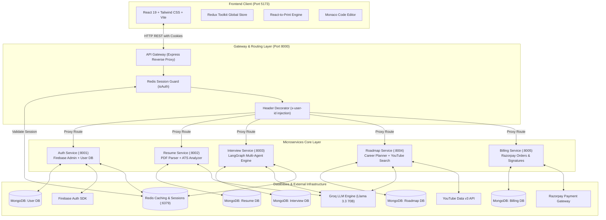
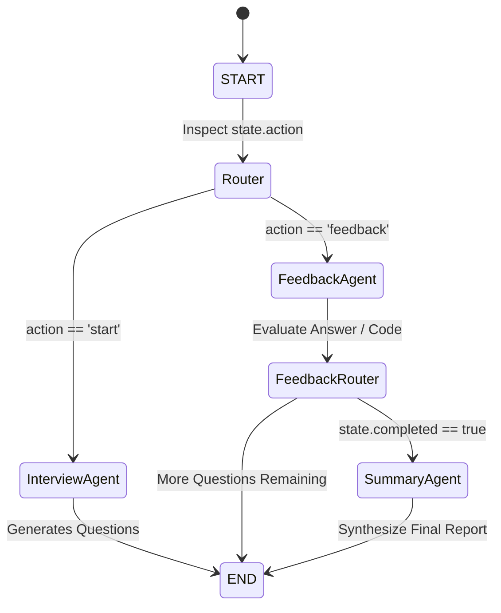
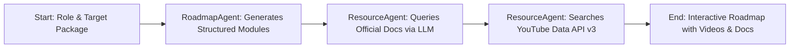

# 🚀 CareerForge AI - Complete Project Explanation & Architectural Guide

---

## 📖 Executive Summary

**CareerForge AI** is an enterprise-grade, end-to-end career acceleration and preparation platform. It simulates real-world hiring pipelines and empowers candidates to sharpen their technical, coding, and behavioral skills through state-of-the-art Generative AI.

Modern hiring pipelines rely heavily on Automated Tracking Systems (ATS) and demanding multi-stage technical and behavioral interviews. Job candidates frequently struggle with:
1. **Opaque Resume Screening**: Resumes get filtered out by ATS algorithms without transparent feedback.
2. **Lack of Realistic Technical Interview Practice**: Coding platforms offer problem sets but lack the conversational, adaptive questioning of a human engineering interviewer.
3. **Fragmented Learning Paths**: Learners waste hours finding quality tutorials, documentation, and structured roadmaps that align with specific salary and seniority expectations.
4. **Expensive 1-on-1 Mentorship**: Professional interview coaching is costly and inaccessible to the majority of students and transitioning engineers.

**CareerForge AI** solves these challenges by combining **LangGraph Multi-Agent Workflows**, **Groq LPU LLM inference**, an **Express Microservices API Gateway**, **Redis distributed sessions**, and an interactive **React 19 + Vite** frontend.

---

## 🏗️ System Architecture & Engineering Philosophy

CareerForge AI is architected as an event-ready, distributed microservices system rather than a monolithic application. This ensures high availability, independent service deployment, fault isolation, and horizontal scalability.



---

## 🧠 The AI Multi-Agent Architecture (LangGraph)

The platform leverages **LangGraph** (built by LangChain) to orchestrate stateful, multi-agent AI pipelines. Instead of naive single-prompt completions, complex interactions are broken into specialized agents that cooperate over a shared state graph.

### 1. Mock Interview Multi-Agent Graph (`interview` service)

The interview engine operates as a stateful cyclical state machine:



1. **`InterviewAgent`**:
   - Analyzes candidate profile, target role, and optional parsed resume skills.
   - Tailors either an in-depth **Technical** or **HR Behavioral** question sequence.
   - Enforces structured JSON output without markdown delimiters.
2. **`FeedbackAgent`**:
   - Activated after every answer or Monaco editor code submission.
   - Evaluates technical accuracy, algorithm efficiency, communication clarity, and syntax correctness.
   - Returns real-time coaching feedback and scores the individual question.
3. **`SummaryAgent`**:
   - Automatically triggered when the candidate reaches the end of the question queue.
   - Computes weighted overall performance across technical depth, problem-solving speed, and behavioral alignment.
   - Formulates hiring recommendations and improvement goals.

---

### 2. Roadmap Generation Pipeline (`roadmap` service)



- **`RoadmapAgent`**: Generates a phased learning curriculum based on target market compensation (e.g. 15 LPA vs 40 LPA).
- **`ResourceAgent`**: Inspects each generated module, identifies official documentation URLs, and queries the YouTube Data v3 API for verified tutorial videos.

---

## 💎 Platform Feature Deep-Dive

### 1. AI Mock Interview Simulator & Monaco Code Workspace
- **Dual Tracks**: Supports both **Technical** (data structures, system design, framework-specific questions) and **HR Behavioral** rounds.
- **Resume-Tailored Questions**: Candidates can toggle `"Use Resume"` to test themselves on technologies and accomplishments listed in their uploaded resume.
- **Integrated Monaco Code IDE**: Full syntax highlighting, indentation, and formatting support for JavaScript, Python, Java, C++, and more.
- **Audio/Camera Simulation**: Real-time webcam preview to simulate real video interview conditions.
- **Analytics Scorecard**: Displays detailed radar charts powered by **Recharts**, highlighting scores across Communication, Technical Proficiency, and Problem Solving.

### 2. ATS Resume Analyzer & Scorer
- **High-Fidelity PDF Parsing**: Converts candidate PDF uploads into structured plain text using `pdf-parse`.
- **ATS Scoring Engine**: Evaluates layout compatibility, quantitative impact metrics, action verb usage, and job keyword densities.
- **Actionable Gap Analysis**: Pinpoints exact missing skills required for the targeted job role and lists concrete revisions to improve screening pass rates.

### 3. Interactive ATS-Friendly Resume Builder
- **Dynamic Form Synchronization**: Live, accordion-style form sections for Personal Details, Professional Summary, Technical Skills, Projects, Experience, and Education.
- **Global State Synchronization**: Leverages **Redux Toolkit** to automatically prefill form fields from the parsed ATS resume.
- **Pixel-Perfect Print Template**: Single-column, clean typography specifically engineered to pass automated applicant tracking parsers.
- **Zero-Distortion PDF Generation**: Powered by `react-to-print`, generating vector-crisp PDF documents directly from the browser DOM.

### 4. Adaptive Career Roadmap Generator
- **Goal-Oriented Progression**: Tailored to target industry compensation (e.g., 6 LPA, 12 LPA, 25 LPA+).
- **Embedded Media & Reference Links**: Each milestone card provides direct links to official documentation and curated YouTube video lectures.
- **Interactive Checklists**: Candidates can mark modules as completed to track learning momentum.

### 5. Coin-Based Credit Economy & Billing System
- **Transparent Coin Metering**:
  - Mock Interview Session: 50 coins
  - ATS Resume Scoring: 25 coins
  - Career Roadmap Generation: 20 coins
- **Welcome Allocation**: Every new user receives **150 free coins** upon first Google Sign-In.
- **Razorpay Integration**:
  - Secure order creation via Razorpay Orders API.
  - Client-side checkout modal.
  - Server-side cryptographic signature validation using HMAC-SHA256 before granting coins.
  - Real-time Redis session updates ensuring instant coin balance reflection without requiring re-login.

---

## 🔒 Security Architecture & Secret Safeguards

Security has been prioritized across every layer of the application:

1. **HttpOnly, Secure Cookies**:
   - Session identifiers are stored in `httpOnly`, `secure`, `sameSite: "none"` cookies.
   - Protects against Cross-Site Scripting (XSS) token theft.
2. **Centralized Authentication at API Gateway**:
   - Downstream microservices are sheltered behind the gateway and only accept verified requests carrying the `x-user-id` header.
3. **Strict Git Ignore Protocols**:
   - All `.env` files, MongoDB credentials, Firebase service account keys, and private certificates are strictly excluded from version control.
   - Clean `.env.example` templates and `serviceAccountKey.example.json` are maintained for collaborative development.
4. **Data Isolation**:
   - User uploaded resumes (`backend/services/resume/uploads/`) are isolated and excluded from version control.
   - MongoDB database names are separated per microservice (`user`, `resume`, `interview`, `roadmap`, `billing`).

---

## 🛠️ Step-by-Step Developer Setup Guide

### 1. Prerequisites
- **Node.js** (v18.x or v20.x recommended)
- **Docker Desktop** (running for Redis)
- **Git**

### 2. Environment Setup
Copy the sample environment templates across all services:

```bash
# Gateway
cp backend/gateway/.env.example backend/gateway/.env

# Auth Service
cp backend/services/auth/.env.example backend/services/auth/.env
cp backend/services/auth/serviceAccountKey.example.json backend/services/auth/serviceAccountKey.json

# Billing Service
cp backend/services/billing/.env.example backend/services/billing/.env

# Interview Service
cp backend/services/interview/.env.example backend/services/interview/.env

# Resume Service
cp backend/services/resume/.env.example backend/services/resume/.env

# Roadmap Service
cp backend/services/roadmap/.env.example backend/services/roadmap/.env

# Frontend
cp frontend/.env.example frontend/.env
```

### 3. Install Dependencies
```bash
# Install backend root dependencies
cd backend && npm install

# Install each service's dependencies
cd gateway && npm install
cd ../services/auth && npm install
cd ../billing && npm install
cd ../interview && npm install
cd ../resume && npm install
cd ../roadmap && npm install

# Install frontend dependencies
cd ../../../frontend && npm install
```

### 4. Running the Platform
- **Windows (One-Click)**:
  Double-click or run `.\start-all.bat` from the root directory.
- **Manual Launch**:
  Follow the step-by-step terminal commands outlined in [README.md](file:///e:/Dev-projects/CareerForge%20AI/README.md).

---

## 📤 How to Push This Repository to GitHub

Because the `.gitignore` file is configured and verified, you can safely initialize and push the repository without leaking credentials:

```bash
# 1. Initialize git (if not already done)
git init

# 2. Stage all safe files
git add .

# 3. Verify that NO .env or serviceAccountKey.json files are staged
git status

# 4. Create your initial commit
git commit -m "feat: initial commit of CareerForge AI platform"

# 5. Set default branch to main
git branch -M main

# 6. Add your GitHub repository remote
git remote add origin https://github.com/<your-username>/<your-repo-name>.git

# 7. Push to GitHub
git push -u origin main
```

---

## 🎯 Conclusion

**CareerForge AI** bridges the gap between passive learning and high-stakes technical interviews. Its modern distributed architecture, coupled with LangGraph's multi-agent workflows and Groq's high-speed inference, delivers a responsive, enterprise-grade user experience ready for production deployment.
