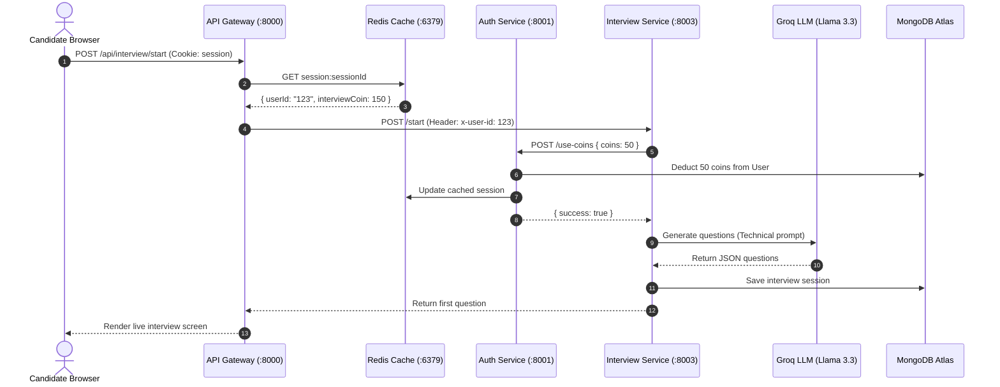

# 🏗️ CareerForge AI - Project Structure & Code Logic Guide

This document provides a comprehensive breakdown of the entire **CareerForge AI** codebase. It details every directory, file, and submodule, explaining their respective responsibilities, internal code logic, exported interfaces, and inter-service dependencies.

---

## 📑 Table of Contents
1. [High-Level Directory Map](#-high-level-directory-map)
2. [Root Configuration & Orchestration Scripts](#-root-configuration--orchestration-scripts)
3. [Backend Architecture](#-backend-architecture)
   - [Shared Infrastructure (`backend/shared`)](#1-shared-infrastructure-backendshared)
   - [API Gateway Service (`backend/gateway`)](#2-api-gateway-service-backendgateway)
   - [Authentication Service (`backend/services/auth`)](#3-authentication-service-backendservicesauth)
   - [Billing & Payments Service (`backend/services/billing`)](#4-billing--payments-service-backendservicesbilling)
   - [Mock Interview Service (`backend/services/interview`)](#5-mock-interview-service-backendservicesinterview)
   - [Resume Analysis & ATS Service (`backend/services/resume`)](#6-resume-analysis--ats-service-backendservicesresume)
   - [Career Roadmap Service (`backend/services/roadmap`)](#7-career-roadmap-service-backendservicesroadmap)
4. [Frontend Architecture (`frontend`)](#-frontend-architecture-frontend)
   - [Application Entry & Routing](#1-application-entry--routing)
   - [State Management & HTTP Layer](#2-state-management--http-layer)
   - [Application Pages](#3-application-pages)
   - [Reusable & Domain-Specific Components](#4-reusable--domain-specific-components)
5. [Data Flow & Inter-Service Communications](#-data-flow--inter-service-communications)

---

## 🌲 High-Level Directory Map

```text
CareerForge AI/
├── .gitignore                                # Global git ignore rules (secures .env, keys, uploads)
├── README.md                                 # Primary repository overview and developer quickstart
├── project_explanation.md                    # Deep-dive architecture, business logic & workflow specs
├── project_structure.md                      # Exhaustive file-by-file logic breakdown (This file)
├── start-all.bat                             # One-click Windows multi-service launch script
├── stop-all.bat                              # One-click shutdown script for background services
│
├── backend/
│   ├── docker-compose.yml                    # Redis Docker container configuration
│   ├── package.json                          # Backend root workspace manifest
│   ├── shared/
│   │   └── redis/redis.js                    # Shared Redis connection client instance
│   │
│   ├── gateway/                              # Central Reverse Proxy & Session Middleware
│   │   ├── index.js                          # Express gateway server entry
│   │   ├── controllers/user.controller.js    # Gateway user controller (/api/me)
│   │   ├── middleware/isAuth.js              # Redis session verification middleware
│   │   ├── utils/proxyWithHeaders.js         # HTTP proxy decorator injecting x-user-id
│   │   ├── Dockerfile                        # Gateway containerization recipe
│   │   ├── .env.example                      # Gateway environment template
│   │   └── package.json
│   │
│   └── services/
│       ├── auth/                             # Firebase Auth Sync & Coin Management
│       │   ├── index.js                      # Service entry (Port 8001)
│       │   ├── configs/db.js                 # MongoDB Mongoose connection
│       │   ├── configs/firebase.js           # Firebase Admin SDK initialization
│       │   ├── controllers/auth.controller.js# Login, logout, coin allocation & deduction
│       │   ├── model/user.model.js           # User schema (firebaseUid, email, interviewCoin)
│       │   ├── routes/auth.route.js          # Express route definitions
│       │   ├── serviceAccountKey.example.json# Template for Firebase Admin credentials
│       │   ├── Dockerfile
│       │   ├── .env.example
│       │   └── package.json
│       │
│       ├── billing/                          # Razorpay Integration & Order Management
│       │   ├── index.js                      # Service entry (Port 8005)
│       │   ├── configs/db.js                 # MongoDB connection
│       │   ├── configs/razorpay.js           # Razorpay SDK instance initialization
│       │   ├── controllers/billing.controller.js # Order creation & SHA256 HMAC signature verification
│       │   ├── models/billing.model.js       # Billing order transaction schema
│       │   ├── routes/billing.route.js       # Order and verification routes
│       │   ├── Dockerfile
│       │   ├── .env.example
│       │   └── package.json
│       │
│       ├── interview/                        # LangGraph Multi-Agent Interview Engine
│       │   ├── index.js                      # Service entry (Port 8003)
│       │   ├── config/db.js                  # MongoDB connection
│       │   ├── config/llm.js                 # Groq ChatGroq LLM client (Llama 3.3 70B)
│       │   ├── models/interview.model.js     # Interview session, questions & scoring schema
│       │   ├── agents/interview.agent.js     # Question generation agent
│       │   ├── agents/feedback.agent.js      # Real-time answer evaluation agent
│       │   ├── agents/summary.agent.js       # Final scorecard and analytics synthesis agent
│       │   ├── graph/state.js                # LangGraph Annotation state definition
│       │   ├── graph/nodes.js                # State graph execution nodes
│       │   ├── graph/graph.js                # Compiled LangGraph state machine with routers
│       │   ├── prompts/                      # Detailed system prompts for HR, Tech, Eval, Summary
│       │   ├── controllers/interview.controller.js # Session lifecycle controllers & cache
│       │   ├── routes/interview.route.js     # Interview REST endpoints
│       │   ├── Dockerfile
│       │   ├── .env.example
│       │   └── package.json
│       │
│       ├── resume/                           # ATS Parser & Resume Analyzer
│       │   ├── index.js                      # Service entry (Port 8002)
│       │   ├── config/db.js                  # MongoDB connection
│       │   ├── config/llm.js                 # Groq LLM client
│       │   ├── config/pdf.js                 # PDF text extraction using pdf-parse
│       │   ├── middleware/multer.js          # Disk storage file upload handler
│       │   ├── agents/resume.agent.js        # AI ATS scoring & structured extraction agent
│       │   ├── models/resume.model.js        # Resume record and score breakdown schema
│       │   ├── controllers/resume.controller.js # Upload, extraction & retrieval logic
│       │   ├── routes/resume.route.js        # Upload & get-resume endpoints
│       │   ├── uploads/.gitkeep              # Directory anchor (actual PDFs git-ignored)
│       │   ├── Dockerfile
│       │   ├── .env.example
│       │   └── package.json
│       │
│       └── roadmap/                          # Career Path & YouTube Resource Generator
│           ├── index.js                      # Service entry (Port 8004)
│           ├── configs/db.js                 # MongoDB connection
│           ├── configs/llm.js                # Groq LLM client
│           ├── configs/youtube.js            # YouTube Data v3 API search integration
│           ├── configs/roadmap.prompt.js     # Structured roadmap generation prompt
│           ├── models/roadmap.model.js       # Learning modules & milestones schema
│           ├── graph/roadmap.state.js        # LangGraph State definition for roadmap
│           ├── graph/roadmap.graph.js        # Two-agent sequential pipeline graph
│           ├── agents/roadmap.agent.js       # Syllabus & milestone architect agent
│           ├── agents/resource.agent.js      # Documentation & video lookup agent
│           ├── controllers/roadmap.controller.js # Generation & caching controllers
│           ├── routes/roadmap.route.js       # Roadmap endpoints
│           ├── Dockerfile
│           ├── .env.example
│           └── package.json
│
└── frontend/                                 # React 19 + Vite SPA Client
    ├── index.html                            # HTML entry point with title and fonts
    ├── vite.config.js                        # Vite build and dev server configuration
    ├── package.json                          # Frontend dependencies (React, Redux, Tailwind, Monaco)
    ├── .gitignore                            # Frontend-specific git exclusions
    ├── .env.example                          # Frontend environment variables template
    │
    └── src/
        ├── main.jsx                          # React DOM root render with Redux Provider
        ├── App.jsx                           # Route declarations & auth check lifecycle
        ├── index.css                         # Tailwind CSS directives and global rules
        ├── App.css                           # Component styling overrides
        │
        ├── redux/
        │   ├── store.js                      # Redux store configuration
        │   └── resumeSlice.js                # Global resume state slice
        │
        ├── utils/
        │   ├── axios.js                      # Axios instance configured with credentials: true
        │   └── firebase.js                   # Client Firebase Auth initialization
        │
        ├── apis/
        │   ├── user.api.js                   # User auth, login, logout, current user requests
        │   ├── resume.api.js                 # Resume upload and get-resume API calls
        │   └── interview.api.js              # Mock interview start, answer, report API calls
        │
        ├── assets/                           # Media files (AI avatars male/female, logos, mockups)
        │
        ├── pages/
        │   ├── Home.jsx                      # Landing page with marketing hero and features
        │   ├── Dashboard.jsx                 # User overview, quick stats, coin balance
        │   ├── Scorer.jsx                    # PDF drag-and-drop upload and ATS score dashboard
        │   ├── ResumeBuilder.jsx             # Live resume form and ATS-friendly preview
        │   ├── InterviewStart.jsx            # Interview configuration wizard
        │   ├── InterviewPage.jsx             # Live mock interview interface (chat + Monaco IDE)
        │   ├── InterviewReport.jsx           # Post-interview detailed score analytics
        │   ├── Roadmap.jsx                   # Career goal roadmap generator and checklist
        │   └── Billing.jsx                   # Coin plans, pricing cards, Razorpay checkout
        │
        └── components/
            ├── Sidebar.jsx                   # Persistent navigation drawer with user coins
            ├── LoginModel.jsx                # Firebase Google Sign-In authentication modal
            ├── PricingCard.jsx               # Tier pricing card with buy button
            ├── Statbox.jsx                   # Metric summary badge component
            ├── InterviewGraph.jsx            # Recharts radar/bar analytics visualizer
            │
            ├── interview/
            │   ├── Step1setup.jsx            # Wizard: role selection, mode, resume toggle
            │   ├── Step2interview.jsx        # Question presenter, answer input, camera feed
            │   ├── Step3report.jsx           # Scorecard with feedback breakdown
            │   ├── CodeEditor.jsx            # Monaco editor with language selection & syntax
            │   └── Timer.jsx                 # Real-time interview countdown component
            │
            ├── resume/
            │   ├── initialData.js            # Default resume schema template
            │   ├── ResumeForm.jsx            # Multi-section resume input accordion
            │   ├── PreviewResume.jsx         # Live printable preview pane
            │   ├── ATSTemplate.jsx           # Single-column ATS-optimized paper template
            │   └── DownloadBtn.jsx           # React-to-Print PDF export button
            │
            └── roadmap/
                ├── ModuleCard.jsx            # Milestone card with YouTube & doc links
                └── RoadmapResult.jsx         # Full interactive roadmap timeline display
```

---

## 🛠️ Root Configuration & Orchestration Scripts

### 1. `.gitignore`
- **Purpose**: Defines patterns for files and directories that Git must ignore.
- **Key Rules**:
  - `*.env*` and `atlas-credentials.env`: Ensures no environment files or database connection strings are pushed to GitHub.
  - `*firebase-adminsdk*.json` and `serviceAccountKey.json`: Strictly blocks private keys from being exposed.
  - `backend/services/resume/uploads/*`: Blocks any uploaded user PDF files from being tracked, while preserving the directory via `!backend/services/resume/uploads/.gitkeep`.
  - `node_modules/`, `dist/`, `*.log`: Ignores all package installations, builds, and logs.
  - Exceptions: Whitelists `!*.env.example` and `!serviceAccountKey.example.json` so repository clones have functional setup templates.

### 2. `start-all.bat`
- **Purpose**: Windows automation script that spins up the entire distributed system in parallel with a single double-click.
- **Logic**:
  1. Starts Docker Compose (`docker compose up`) in `backend/` to run Redis on port `6379`.
  2. Waits 3 seconds for Redis to become available.
  3. Launches 7 distinct, titled `cmd.exe` windows running `npm run dev` for:
     - API Gateway (`:8000`)
     - Auth Service (`:8001`)
     - Billing Service (`:8005`)
     - Interview Service (`:8003`)
     - Resume Service (`:8002`)
     - Roadmap Service (`:8004`)
     - Frontend Vite App (`:5173`)
  4. Keeps each window independent so developers can monitor real-time logs per microservice.

### 3. `stop-all.bat`
- **Purpose**: Graceful shutdown script for background processes and Docker containers.
- **Logic**: Executes `docker compose down` inside `backend/` to cleanly terminate and remove Redis containers.

---

## ⚙️ Backend Architecture

### 1. Shared Infrastructure (`backend/shared`)

#### `backend/shared/redis/redis.js`
- **Purpose**: Provides a unified singleton `ioredis` client used across the gateway and microservices.
- **Logic**:
  - Connects to the Redis URI specified by `process.env.REDIS_URL` (defaults to `redis://localhost:6379`).
  - Registers an event listener on `"connect"` to log active connection state.
  - Exports the `redis` instance for session storage, user caching, and rate limiting.

---

### 2. API Gateway Service (`backend/gateway`)

The Gateway is the unified reverse proxy entry point for all client requests on port `8000`.

#### `backend/gateway/index.js`
- **Purpose**: Express server that proxies incoming client requests to downstream microservices based on URL path prefixes.
- **Logic**:
  - Sets up CORS with `credentials: true` restricted to `process.env.FRONTEND_URL`.
  - Parses incoming JSON and cookies using `cookie-parser`.
  - Applies Morgan logging in `dev` mode.
  - Routes:
    - `/api/auth` $\rightarrow$ Forwarded directly to Auth Service (`:8001`) via `proxy(process.env.AUTH_SERVICE_URL)`.
    - `/api/me` $\rightarrow$ Protected by `isAuth`; invokes `getCurrentUser`.
    - `/api/resume` $\rightarrow$ Protected by `isAuth`; routed via `proxyWithHeaders(process.env.RESUME_SERVICE_URL)`.
    - `/api/interview` $\rightarrow$ Protected by `isAuth`; routed via `proxyWithHeaders(process.env.INTERVIEW_SERVICE_URL)`.
    - `/api/roadmap` $\rightarrow$ Protected by `isAuth`; routed via `proxyWithHeaders(process.env.ROADMAP_SERVICE_URL)`.
    - `/api/billing` $\rightarrow$ Protected by `isAuth`; routed via `proxyWithHeaders(process.env.BILLING_SERVICE_URL)`.

#### `backend/gateway/middleware/isAuth.js`
- **Purpose**: Centralized authentication guard for all protected endpoints.
- **Logic**:
  - Extracts the `session` cookie from `req.cookies?.session`.
  - If absent, returns `401 Unauthorized`.
  - Queries Redis for key `session:${sessionId}`.
  - If not found or expired, returns `401 Session Expired`.
  - Parses the JSON session string and attaches the session payload (`userId`, `name`, `email`, `interviewCoin`) directly to `req.user`.
  - Calls `next()`.

#### `backend/gateway/utils/proxyWithHeaders.js`
- **Purpose**: Decorates downstream proxy requests with verified identity headers.
- **Logic**:
  - Wraps `express-http-proxy`.
  - Implements `proxyReqOptDecorator`: checks if `srcReq.user` exists, and injects `proxyReqOpts.headers["x-user-id"] = srcReq.user.userId`.
  - Downstream microservices can thus trust `x-user-id` without re-verifying session cookies.

#### `backend/gateway/controllers/user.controller.js`
- **Purpose**: Handles identity confirmation requests.
- **Logic**:
  - `getCurrentUser`: Returns `{ success: true, user: req.user }` using the session data attached by `isAuth`.

---

### 3. Authentication Service (`backend/services/auth`)

Manages user registration, Firebase authentication synchronization, session creation in Redis, and coin economy management.

#### `backend/services/auth/index.js`
- **Purpose**: Express app entry running on port `8001`.
- **Logic**: Initializes database via `connectDb()`, attaches JSON parser, cookie parser, and mounts `authRouter` under root `/`.

#### `backend/services/auth/configs/db.js`
- **Purpose**: Establishes Mongoose connection with MongoDB Atlas for the Auth database.
- **Logic**: Calls `mongoose.connect(process.env.MONGODB_URL)` with error handling.

#### `backend/services/auth/configs/firebase.js`
- **Purpose**: Initializes the Firebase Admin SDK.
- **Logic**: Reads `serviceAccountKey.json` and calls `initializeApp({ credential: cert(serviceAccount) })`.

#### `backend/services/auth/model/user.model.js`
- **Purpose**: Mongoose schema definition for user entities.
- **Fields**:
  - `firebaseUid` (String, required, unique): Firebase user UID.
  - `name` (String): Candidate full name.
  - `email` (String, required, unique): Verified email address.
  - `interviewCoin` (Number, default: 150): User's available platform credits.
  - `timestamps: true`: Auto-creates `createdAt` and `updatedAt`.

#### `backend/services/auth/controllers/auth.controller.js`
- **Purpose**: Business logic for login, logout, and coin deductions/additions.
- **Methods**:
  - `login(req, res)`:
    - Receives Firebase ID token from client.
    - Calls `getAuth(app).verifyIdToken(token)` to verify Google authentication.
    - Finds existing user by `firebaseUid` or creates a new user (with 150 starting coins).
    - Generates a cryptographically random session UUID (`crypto.randomUUID()`).
    - Saves session in Redis at `session:${sessionId}` for 7 days (`EX: 604800`).
    - Issues `httpOnly`, `secure`, `sameSite: "none"` cookie named `session`.
  - `logout(req, res)`:
    - Deletes `session:${sessionId}` from Redis.
    - Clears the `session` cookie.
  - `useInterviewCoins(req, res)`:
    - Validates session from cookie.
    - Ensures user has $\ge$ required `coins`. If insufficient, returns `403`.
    - Atomically decrements `user.interviewCoin`, persists to MongoDB, and updates the cached Redis session object.
  - `addCoins(req, res)`:
    - Adds purchased coins to `user.interviewCoin` after billing verification.
    - Synchronizes Redis session.

#### `backend/services/auth/routes/auth.route.js`
- **Purpose**: Declares REST endpoints for Auth service:
  - `POST /login` $\rightarrow$ `login`
  - `GET /logout` $\rightarrow$ `logout`
  - `POST /add-coins` $\rightarrow$ `addCoins`
  - `POST /use-coins` $\rightarrow$ `useInterviewCoins`

---

### 4. Billing & Payments Service (`backend/services/billing`)

Handles Razorpay order creation, payment signatures verification, and coin credit top-ups.

#### `backend/services/billing/configs/razorpay.js`
- **Purpose**: Initializes the official Razorpay SDK client.
- **Logic**: Instantiates `new Razorpay({ key_id: process.env.RAZORPAY_KEY_ID, key_secret: process.env.RAZORPAY_KEY_SECRET })`.

#### `backend/services/billing/models/billing.model.js`
- **Purpose**: Schema tracking financial transactions.
- **Fields**:
  - `userId` (ObjectId / String, required)
  - `amount` (Number, required)
  - `interviewCoins` (Number, required)
  - `razorpayOrderId` (String, required)
  - `razorpayPaymentId` (String)
  - `razorpaySignature` (String)
  - `status` (`"created" | "paid" | "failed"`, default: `"created"`)

#### `backend/services/billing/controllers/billing.controller.js`
- **Methods**:
  - `createOrder(req, res)`:
    - Identifies target plan (e.g. `starter`: 199 INR for 300 coins).
    - Calls `razorpay.orders.create({ amount: plan.amount * 100, currency: "INR", receipt })`.
    - Creates pending record in `Billing` model.
    - Returns order ID and details to frontend for Razorpay Checkout modal.
  - `verifyPayment(req, res)`:
    - Receives `razorpay_order_id`, `razorpay_payment_id`, and `razorpay_signature`.
    - Computes HMAC SHA256 digest: `crypto.createHmac("sha256", process.env.RAZORPAY_KEY_SECRET).update(order_id + "|" + payment_id).digest("hex")`.
    - If digest matches signature: updates payment status to `"paid"` and returns success (client then triggers coin balance top-up).
    - If mismatched: marks payment as `"failed"`.

---

### 5. Mock Interview Service (`backend/services/interview`)

Orchestrates live AI technical and HR interviews using **LangGraph** multi-agent state machines, Groq LLM inference, and MongoDB session tracking.

#### `backend/services/interview/config/llm.js`
- **Purpose**: Provides configured `ChatGroq` model client.
- **Logic**: Instantiates `ChatGroq({ apiKey: process.env.GROQ_API_KEY, model: "llama-3.3-70b-versatile", temperature: 0.6 })`.

#### `backend/services/interview/models/interview.model.js`
- **Purpose**: Stores complete interview sessions and candidate responses.
- **Schema**:
  - `userId`: Reference to candidate.
  - `type`: `"technical"` or `"hr"`.
  - `role`: Target job position (e.g. "Full Stack Developer").
  - `useResume`: Boolean indicating if interview questions were customized to resume.
  - `questions`: Array of question objects containing question text, difficulty, and expected criteria.
  - `answers`: Array storing candidate answers, code submissions, timestamps, and AI feedback.
  - `report`: Synthesized evaluation report with scores (communication, technical, problem solving), strengths, weaknesses, and hiring recommendation.
  - `status`: `"in-progress"` or `"completed"`.

#### `backend/services/interview/graph/state.js`
- **Purpose**: Defines the shared state schema for LangGraph.
- **Channels**: `action`, `role`, `type`, `useResume`, `resume`, `questions`, `currentQuestion`, `userAnswer`, `code`, `feedback`, `completed`, `summary`.

#### `backend/services/interview/graph/nodes.js`
- **Purpose**: Individual step functions executed in the state graph.
- **Nodes**:
  - `interviewNode`: Calls `interviewAgent(state)` to generate a set of tailored questions.
  - `feedbackNode`: Calls `feedbackAgent(state)` to evaluate the candidate's latest response or code submission.
  - `summaryNode`: Calls `summaryAgent(state)` to compile overall interview feedback and quantitative scores.

#### `backend/services/interview/graph/graph.js`
- **Purpose**: Compiles the LangGraph state machine.
- **Routing Logic**:
  - Starts at `START`.
  - Conditional router checks `state.action`:
    - `"start"` $\rightarrow$ transitions to `interviewNode` $\rightarrow$ ends at `END`.
    - `"feedback"` $\rightarrow$ transitions to `feedbackNode`.
  - `feedbackNode` checks `feedbackRouter`:
    - If `state.completed === true`, proceeds to `summaryNode` $\rightarrow$ `END`.
    - Else, returns immediately to `END`.

#### `backend/services/interview/agents/interview.agent.js`
- **Purpose**: Invokes Groq with either HR or Technical prompt to generate balanced, structured questions in JSON format.

#### `backend/services/interview/agents/feedback.agent.js`
- **Purpose**: Scores candidate answers on clarity, depth, correctness, and code quality; produces constructive feedback per question.

#### `backend/services/interview/agents/summary.agent.js`
- **Purpose**: Synthesizes the overall session: produces an aggregate percentage score, category ratings (0-10), strengths, and growth recommendations.

#### `backend/services/interview/controllers/interview.controller.js`
- **Methods**:
  - `startInterview`: Deducts coins, invokes graph with action `"start"`, saves session in MongoDB, caches in Redis, returns question #1.
  - `submitAnswer`: Accepts candidate answer/code, invokes graph with action `"feedback"`, updates progress. If final question, marks completed and attaches summary.
  - `getInterview`: Fetches specific session details (used for report page).
  - `getAllInterviews`: Lists past interview history for dashboard analytics.

---

### 6. Resume Analysis & ATS Service (`backend/services/resume`)

Parses uploaded resumes, extracts text from PDF documents, evaluates ATS compliance, and generates structured resume data.

#### `backend/services/resume/config/pdf.js`
- **Purpose**: Extracts raw textual content from uploaded PDF files.
- **Logic**: Reads PDF buffer from disk via `fs.readFileSync` and runs `pdf(dataBuffer)` (`pdf-parse`) to return plain text.

#### `backend/services/resume/middleware/multer.js`
- **Purpose**: Handles file upload validation and storage.
- **Logic**: Configures disk storage in `uploads/`, restricts file types to `application/pdf`, and limits max file size to 5MB.

#### `backend/services/resume/agents/resume.agent.js`
- **Purpose**: Analyzes resume content using Groq LLM.
- **Logic**:
  - Supplies candidate text to a strict ATS system prompt.
  - Returns structured JSON containing parsed contact details, skills list, work history, projects, strengths, weaknesses, suggested role, ATS score (0-100), and missing keywords.

#### `backend/services/resume/models/resume.model.js`
- **Purpose**: Stores parsed resume profiles in MongoDB Atlas.
- **Schema**: Maps candidate's extracted data, sanitized arrays, and historical ATS score.

#### `backend/services/resume/controllers/resume.controller.js`
- **Methods**:
  - `uploadResume`: Accepts PDF upload via Multer, extracts text, runs `resumeAgent`, upserts the candidate's `Resume` record in MongoDB, and caches it in Redis.
  - `getResume`: Retrieves the authenticated user's parsed resume for display on the Scorer and Resume Builder pages.

---

### 7. Career Roadmap Service (`backend/services/roadmap`)

Generates structured, step-by-step career progression roadmaps with integrated YouTube tutorials and official documentation.

#### `backend/services/roadmap/configs/youtube.js`
- **Purpose**: Searches YouTube for high-quality tutorial videos matching a roadmap topic.
- **Logic**: Queries YouTube Data API v3 (`https://www.googleapis.com/youtube/v3/search`) using `process.env.YOUTUBE_API_KEY`, extracting title, video ID, and thumbnail.

#### `backend/services/roadmap/agents/roadmap.agent.js`
- **Purpose**: Creates sequential learning modules tailored to the candidate's target role and package tier (e.g. 10 LPA vs 30 LPA).

#### `backend/services/roadmap/agents/resource.agent.js`
- **Purpose**: Augments each module in the roadmap by querying LLM for official documentation URLs and calling `youtube.js` for matching video tutorials.

#### `backend/services/roadmap/graph/roadmap.graph.js`
- **Purpose**: LangGraph pipeline chaining `roadmapAgent` $\rightarrow$ `resourceAgent` $\rightarrow$ `__end__`.

#### `backend/services/roadmap/controllers/roadmap.controller.js`
- **Methods**:
  - `generateRoadmap`: Validates role and package, invokes LangGraph, stores result in MongoDB, and caches in Redis.
  - `getAllRoadmap`: Fetches all roadmaps generated by the user.
  - `getRoadmapbyId`: Retrieves a specific roadmap by ID.

---

## 🎨 Frontend Architecture (`frontend`)

Built with **React 19**, **Vite**, **Tailwind CSS**, and **Redux Toolkit**.

### 1. Application Entry & Routing

#### `frontend/src/main.jsx`
- Mounts the React application to DOM `#root`.
- Wraps `<App />` inside `<Provider store={store}>` and `<BrowserRouter>`.

#### `frontend/src/App.jsx`
- **Routing & Auth Guard**:
  - On mount, calls `getCurrentUser()` to verify active session cookie.
  - If authenticated, redirects `/` to `/dashboard`.
  - Defines routes:
    - `/` $\rightarrow$ `Home` (Landing Page)
    - `/dashboard` $\rightarrow$ `Dashboard`
    - `/scorer` $\rightarrow$ `Scorer` (ATS Resume Checker)
    - `/resume` $\rightarrow$ `ResumeBuilder` (Interactive Resume Generator)
    - `/interview` $\rightarrow$ `InterviewStart` (Interview Setup)
    - `/interview/:id` $\rightarrow$ `InterviewPage` (Live Simulation & Monaco IDE)
    - `/interview/:id/report` $\rightarrow$ `InterviewReport` (Analytics & Charts)
    - `/roadmap` $\rightarrow$ `Roadmap` (Career Learning Paths)
    - `/billing` $\rightarrow$ `Billing` (Coin Packages & Razorpay)

---

### 2. State Management & HTTP Layer

#### `frontend/src/redux/store.js` & `resumeSlice.js`
- Stores resume data globally so the ATS Scorer, Resume Builder, and Mock Interview Wizard can share the parsed candidate profile seamlessly.

#### `frontend/src/utils/axios.js`
- Configures Axios with `baseURL = import.meta.env.VITE_BACKEND_URL` and `withCredentials: true` so the session cookie is transmitted automatically on every request.

#### `frontend/src/utils/firebase.js`
- Initializes client-side Firebase Auth and `GoogleAuthProvider` for popup login.

#### `frontend/src/apis/`
- `user.api.js`: Handles `login`, `logout`, and `getCurrentUser`.
- `resume.api.js`: Handles `uploadResume` (multipart form-data) and `getResume`.
- `interview.api.js`: Handles `startInterview`, `submitAnswer`, and `getInterviewReport`.

---

### 3. Application Pages

- **`Home.jsx`**: High-conversion landing page featuring product showcases, feature highlights, animated video demos, and login CTA.
- **`Dashboard.jsx`**: User cockpit displaying coin balance, quick actions (Start Interview, Check ATS, Build Resume), and past assessment summaries.
- **`Scorer.jsx`**: Drag-and-drop PDF resume uploader displaying an ATS score gauge, key skill gaps, recommendations, and parsed resume preview.
- **`ResumeBuilder.jsx`**: Split-screen live resume builder with real-time editing and printable single-page ATS layout preview.
- **`InterviewStart.jsx`**: Step-by-step setup screen to choose between Technical or HR rounds, job role, and optional resume customization.
- **`InterviewPage.jsx`**: Real-time interview simulator featuring AI interviewer dialogue, text-to-speech/speech input, Monaco code editor, camera preview, and countdown timer.
- **`InterviewReport.jsx`**: Comprehensive post-interview scorecard showing category radar charts (via Recharts), per-question feedback, and improvement milestones.
- **`Roadmap.jsx`**: Career roadmap planner allowing users to input their desired role and target salary package to generate interactive milestone checklists.
- **`Billing.jsx`**: Credit economy dashboard presenting coin pricing tiers with integrated Razorpay modal checkout.

---

### 4. Reusable & Domain-Specific Components

- **`Sidebar.jsx`**: Collapsible modern navigation bar displaying active links, coin counter, and user profile avatar with logout.
- **`LoginModel.jsx`**: Floating modal handling Google OAuth popup authentication.
- **`PricingCard.jsx`**: Responsive card component presenting coin pack details and Razorpay trigger.
- **`InterviewGraph.jsx`**: Visualizes interview competency metrics using Recharts radar charts.
- **`CodeEditor.jsx`**: Monaco editor integration supporting syntax highlighting and code execution formatting.
- **`Timer.jsx`**: Animated countdown clock warning candidates of remaining answer time.
- **`ATSTemplate.jsx`**: Standard single-column, cleanly-formatted resume template designed for maximum ATS machine readability.
- **`DownloadBtn.jsx`**: Trigger using `react-to-print` to output high-fidelity PDFs from the DOM without layout distortion.
- **`ModuleCard.jsx`**: Collapsible accordion item for roadmap modules featuring embedded YouTube tutorial links and documentation buttons.

---

## 🔄 Data Flow & Inter-Service Communications



This modular architecture guarantees that services remain decoupled, resilient, and horizontally scalable while maintaining centralized security and shared Redis caching.
